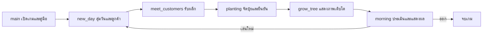

# ชุดเตรียมส่งงาน Grow a (Feeling) Garden

ใช้ฉบับ Mini จาก [ไฟล์ C](ListeningGarden-Mini.c) เป็นฉบับส่งและสาธิต เอกสารนี้ใช้แบ่งงานและซ้อมตามเกณฑ์อาจารย์

## สรุปเกมและวิธีเล่น

เราเปิดร้านรับฟังลูกค้า 8 คนจากตัวละครทั้งหมด 12 คน เลือกคำถามเพื่อฟังเรื่องและรับผลึก 12 ชิ้น พอปิดร้านจึงนำผลึกไปดูแลใบ ราก และเปลือกให้เหมาะกับเหตุการณ์กลางคืน เกมสุ่มเหตุการณ์และลูกค้า แต่จัดผลึกให้มีทางออกดอกด้วยการผสมสองชุด

คอมไพล์ในโฟลเดอร์ Mini แล้วเปิดด้วย PowerShell:

```powershell
gcc -std=c11 -Wall -Wextra -pedantic ListeningGarden-Mini.c -o GardenMini.exe
.\GardenMini.exe
```

หน้าแรกกด 1 เริ่มเล่น, 2 อ่านวิธีเล่น หรือ 0 ออก พอเปิดร้านให้เลือกคำถาม แล้วกด Enter หลังอ่านและรับผลึก

| โต๊ะปลูก | วิธีใช้ |
|---|---|
| 1 ใส่ปุ๋ย | เลือกผลึกและจำนวน ใช้ตรงชิ้นละ 10 หน่วย |
| 2 ผสมปุ๋ย | เลือกผลึกต่างกลุ่มสองชนิดและจำนวนชุด ชุดละ 10 หน่วยให้กลุ่มที่เหลือ |
| 3 คืนผลึกทั้งหมด | คืนคลังและค่าปุ๋ยไปเท่าตอนเริ่มจัดแผน |
| 4 ปลูกและปิดร้าน | กด 1 ยืนยัน หรือ 0 กลับไปจัดแผน |
| 5 ดูสูตร | ดู 12 สูตรโดยไม่เสียผลึก |

สุขกับภูมิใจบำรุงใบและดอก เศร้ากับกลัวบำรุงราก โกรธกับผิดหวังบำรุงเปลือก ตัวอย่างที่สาธิตได้เมื่อมีผลึกในคลัง กด 2 เลือกสุขกับกลัว แล้วใส่จำนวน 1 เกมหักอย่างละชิ้นและเพิ่มเปลือก 10 หน่วย

ต้นรอดเมื่อมีปุ๋ยครบทั้งสามส่วนอย่างน้อยส่วนละ 10 และสุขภาพยังเหลือ อ่านพยากรณ์กับผลคาดการณ์บนโต๊ะปลูก ถ้าสุขภาพเต็มและถึงเป้าออกดอก จะได้ Perfect

| เหตุการณ์ | เป้าใบ / ราก / เปลือก |
|---|---|
| พายุ | 20 / 40 / 30 |
| แล้ง | 30 / 40 / 20 |
| แมลง | 30 / 20 / 40 |

หลังยืนยันปลูก กด Enter ดูต้นไม้โตตามที่เกมบอก แล้วกด 1 รอถึงเช้า ดูผลปลูกและคะแนน จากนั้นกด 1 เล่นใหม่ หรือ 0 ออก

## แผนผังและจุดที่ต้องอธิบาย



- **Array** — `bag[6]` เก็บจำนวนผลึก และ `value[3]` เก็บค่าปุ๋ยของใบ ราก และเปลือก
- **Pointer** — `&plan` คือที่อยู่ของแผนใน `main` ส่วน `Plan *p` คือการประกาศพอยน์เตอร์ที่รับที่อยู่นั้น `*p` คือข้อมูลแผนที่พอยน์เตอร์ชี้ และ `p->bag` ใช้เข้าถึงคลัง การหักผลึกในฟังก์ชันจึงมีผลกับแผนจริง
- **Function** — ซ้อมไล่ `add_fertilizer` จากเลือกผลึก → ตรวจกลุ่มและจำนวน → หักคลัง → เพิ่มค่า แล้วตามไปดู `evaluate` ว่าค่าที่เปลี่ยนส่งผลอย่างไร
- **แก้สด** — ลองเปลี่ยนข้อความชื่อเกมใน `main` คอมไพล์ใหม่และรันให้เห็นผล จากนั้นซ้อมอ่านบรรทัดที่อาจารย์ชี้โดยอธิบายว่ารับค่าอะไร เปลี่ยนค่าอะไร และทำไมต้องทำ

## เช็กลิสต์ตามเกณฑ์ 100 คะแนน

| หมวด | คะแนน | สิ่งที่ทีมต้องทำ |
|---|---:|---|
| รายงาน ความครบถ้วน | 10 | ใส่ภาพรวม คำสั่งคอมไพล์และรัน วิธีใช้ทุกเมนู ตัวอย่าง input/output และภาพจริงจาก Mini |
| รายงาน ความชัดเจน | 10 | ให้เพื่อนที่ไม่เคยเล่นทำตามคู่มือโดยไม่บอกปากเปล่า แล้วแก้จุดที่ติด |
| รายงาน การออกแบบ | 10 | ใส่แผนผัง อธิบายฟังก์ชันหลักและชี้ตัวอย่าง pointer, array, function จากโค้ด |
| รายงาน รูปแบบและภาษา | 5 | จัดหัวข้อ ตรวจคำผิด ใส่คำบรรยายใต้ภาพ |
| สาธิต โปรแกรมทำงานจริง | 15 | เปิดคู่มือ ลองพิมพ์เลขเกินช่วง ลองผสมและคืนผลึก แล้วเล่นจนเห็นผลปลูก |
| สาธิต เนื้อหาและลำดับ | 10 | เล่าโจทย์ → การออกแบบ → สาธิต → สรุปข้อจำกัด เช่น ทุกรอบต้องผสมสองชุดจึงออกดอก |
| สาธิต การพูด | 5 | แบ่งช่วงให้ทุกคนพูด ซ้อมจับเวลาจริง |
| สาธิต สไลด์ | 5 | ใช้ข้อความสั้น ภาพเกมอ่านได้ และแสดงโค้ดเฉพาะช่วงที่อธิบาย |
| ตอบคำถามรายบุคคล เข้าใจโค้ด | 12 | ทุกคนซ้อมไล่ฟังก์ชันที่อาจารย์อาจชี้ทีละบรรทัด |
| ตอบคำถามรายบุคคล เข้าใจแนวคิด | 8 | อธิบายเหตุผลที่ส่งที่อยู่ และหน้าที่ของ & กับ * ให้ได้ด้วยตัวเอง |
| ตอบคำถามรายบุคคล แก้สด | 5 | ซ้อมแก้จุดเล็ก ๆ แล้วคอมไพล์และรันให้เห็นผล |
| เวลา ส่งรายงาน | 2 | ส่งตามกำหนด |
| เวลา เข้าห้องนำเสนอ | 1 | สมาชิกแต่ละคนมาถึงพร้อมตามเวลานัด |
| เวลา จบการนำเสนอ | 2 | ซ้อมให้จบภายในเวลาที่อาจารย์กำหนด |

ก่อนส่ง ให้ทีมเติมภาพจริงพร้อมคำบรรยายอย่างน้อยหน้าเปิดร้าน โต๊ะปลูก และผลตอนเช้า ตรวจรายงานกับสไลด์ว่าตรงกับ Mini รุ่นเดียวกัน แล้วซ้อมบนเครื่องที่จะใช้สาธิต
